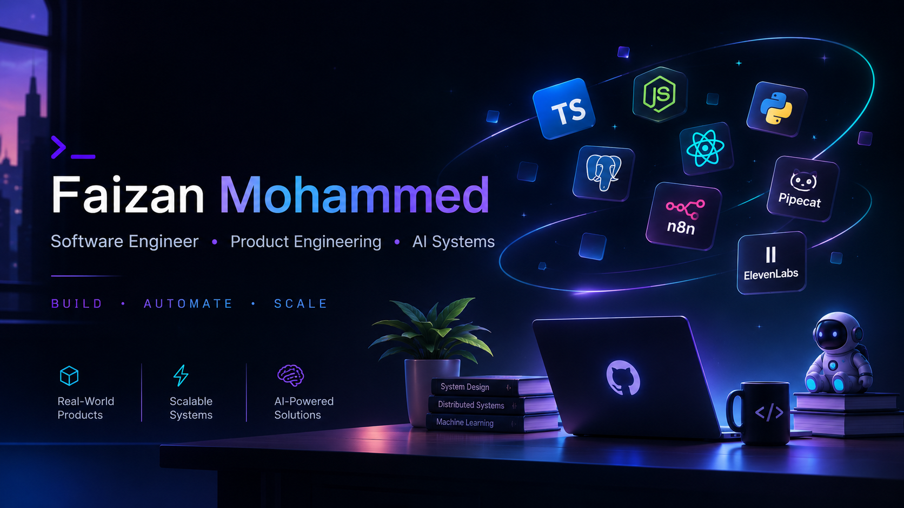

 

# FAIZAN MOHAMMED

Backend systems, intelligent workflows, and products designed around real-world problems.

 

---

## A LITTLE ABOUT THE WORK

<table>
<tr>
<td align="center" width="33%">
<h1>130+</h1>
API endpoints contributed to
</td>
<td align="center" width="33%">
<h1>94%</h1>
Fewer webhook triggers
</td>
<td align="center" width="33%">
<h1>70 → 90%</h1>
Regression / persistence stability
</td>
</tr>
</table>

---

## ✦ SELECTED WORK

### 01 / Voice AI Doctor Appointment Booking

**Real-time voice · Conversational AI · Tool calling**

Building a voice-based appointment booking experience introduced me to a completely different side of application engineering.

I got to explore **WebRTC, speech-to-text, text-to-speech**, and the little details that make a voice conversation feel natural. One particularly interesting discovery was how Voice Activity Detection (VAD) and pause handling can prevent unnecessary ElevenLabs usage when the caller isn't actually speaking.

ElevenLabs was a rabbit hole of its own. Exploring its voice library, experimenting with different voices, and stumbling across those philosophical quotes in the voice samples was genuinely fun.

And then there's **Pipecat**. Probably my favourite part of the exploration. I enjoyed understanding how its pipeline philosophy brings together audio processing, tool calling, and conversational infrastructure. I especially liked how opinionated it is about the pipeline, while remaining largely unopinionated about transports, providers, and deployment.

It gave me a much better appreciation of what it takes to build real-time conversational systems.

  

---

### 02 / QTrack Lite

**Queue management · Concurrency · Full-stack engineering**

While building QTrack Lite, I learned that a queue is a lot more than handing someone the next number.

I got to work across the whole journey: a customer joins through a simple public page, watches their place update, and the shop owner moves the line forward from a dashboard.

The part that really made me think was handling people joining or being called at the same time. **PostgreSQL transactions and row locks** helped me make sure tokens stay in order and nobody accidentally gets skipped.

I also learned how much the little details matter: resetting queues according to the shop's timezone, protecting customer lookups, and keeping useful logs without spilling private information.

And I had fun bringing the whole thing together with React, Express, and Docker — turning what could have been a paper sign-in sheet into a small, working system.

  

---

## ✦ PROFESSIONAL EXPERIENCE

### Software Engineer — Eight Cubic Feet

Product engineering · ArtIntOO · AI & Automation Systems

Working across product development, backend engineering, integrations, and AI-powered business workflows.

I enjoy getting beyond the immediate implementation — understanding the business workflow, identifying system boundaries, and finding ways to make solutions more reliable, reusable, and economical to operate.

**Some of the engineering work:**

- Backend APIs, service architecture, and persistence layers.
- AI-powered workflows and reusable n8n sub-workflows.
- WhatsApp Business, Meta APIs, Twilio, and voice integrations.
- Gmail API, Google Pub/Sub, Calendar integrations, and event-driven automation.
- Speech processing, LLM integrations, and application workflows.
- Webhook optimization, backend performance, and regression reliability.

---

## ✦ THE TOOLBOX

 

### 01 — Languages

### 02 — Backend & Data

### 03 — Frontend & Application

### 04 — AI, Voice & Automation

  

### 05 — Integrations & Infrastructure

 

---

 

Distributed Systems · Event-driven Architecture · AI Agents · Real-time Communication

  

  

