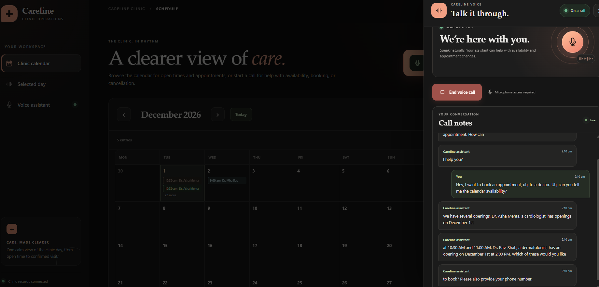
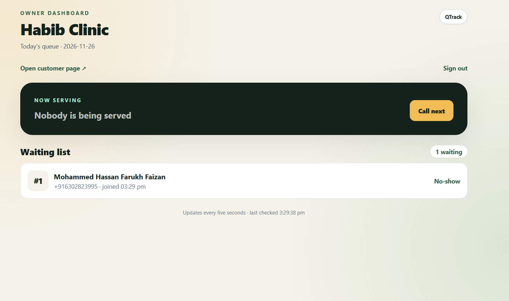

# FAIZAN MOHAMMED

### Software Engineer · Product Engineering · AI Systems

I build software around problems worth solving.

Backend systems, intelligent workflows, and products designed with real-world constraints in mind.

 

---

| **130+** | **94%** | **70 → 90%** |
|:---:|:---:|:---:|
| API endpoints contributed to | Webhook trigger reduction | Regression / persistence stability |

Highlights from professional engineering work

 

## SELECTED WORK

*Two personal projects. Two very different engineering rabbit holes.*

### 01 — Voice AI Doctor Appointment Booking

**Real-time voice · Conversational AI · Tool calling**

Building a voice-based appointment booking experience introduced me to a completely different side of application engineering.

I got to explore WebRTC, speech-to-text, text-to-speech, and the little details that make a voice conversation feel natural. One particularly interesting discovery was how Voice Activity Detection (VAD) and pause handling can prevent unnecessary ElevenLabs usage when the caller isn't actually speaking.

ElevenLabs was a rabbit hole of its own. Exploring its voice library, experimenting with different voices, and stumbling across those philosophical quotes in the voice samples was genuinely fun.

And then there's **Pipecat**. Probably my favourite part of the exploration. I enjoyed understanding how its pipeline philosophy brings together audio processing, tool calling, and conversational infrastructure. I especially liked how opinionated it is about the pipeline, while remaining largely unopinionated about transports, providers, and deployment.

It gave me a much better appreciation of what it takes to build real-time conversational systems.

`Python` &nbsp; `Pipecat` &nbsp; `WebRTC` &nbsp; `ElevenLabs` &nbsp; `STT / TTS` &nbsp; `VAD`

<a href="https://github.com/FaizanMohd5/voice-ai-doctor-appointment-booking">EXPLORE REPOSITORY ↗</a>

---

### 02 — QTrack Lite

**Queue management · Concurrency · Full-stack engineering**

While building QTrack Lite, I learned that a queue is a lot more than handing someone the next number.

I got to work across the whole journey: a customer joins through a simple public page, watches their place update, and the shop owner moves the line forward from a dashboard.

The part that really made me think was handling people joining or being called at the same time. PostgreSQL transactions and row locks helped me make sure tokens stay in order and nobody accidentally gets skipped.

I also learned how much the little details matter: resetting queues according to the shop's timezone, protecting customer lookups, and keeping useful logs without spilling private information.

And I had fun bringing the whole thing together with React, Express, and Docker — turning what could have been a paper sign-in sheet into a small, working system.

`React` &nbsp; `Express.js` &nbsp; `PostgreSQL` &nbsp; `Prisma` &nbsp; `Docker`

<a href="YOUR_QTRACK_LITE_REPO_URL">EXPLORE REPOSITORY ↗</a>

---

## PROFESSIONAL EXPERIENCE

### Software Engineer — Eight Cubic Feet
Product engineering · ArtIntOO · AI & Automation Systems

Working across product development, backend engineering, integrations, and AI-powered business workflows.

My work has involved understanding business requirements, designing service boundaries, building integrations, and making systems more reliable and economical to operate.

A few areas I've worked across:

- Backend APIs, persistence layers, and service architecture.
- AI-powered workflows and reusable n8n sub-workflows.
- WhatsApp Business, Meta APIs, Twilio, and voice integrations.
- Gmail API, Google Pub/Sub, Calendar integrations, and event-driven automation.
- Speech processing, LLM integrations, and application workflows.
- Backend performance, webhook optimization, and regression reliability.

**Selected engineering impact**

- 130+ API endpoints contributed to across the product platform.
- Reduced Meta webhook processing triggers from 50 to 3 relevant events per message.
- Improved persistence and regression stability from approximately 70% to 90%.

TypeScript · Node.js · Python · NestJS · Express · PostgreSQL · Prisma · Redis · Next.js · n8n · Docker

---

## THE TOOLBOX

*Tools are just tools. Understanding where and why to use them is the interesting part.*

### Languages & Core Stack

 

### Backend & Data

 

### AI, Voice & Automation

 

### Integrations & Infrastructure

---

### Curious about the systems behind the software.

Distributed systems · Event-driven architecture · AI agents · Real-time communication

 

<a href="https://linkedin.com/in/mohammed-faizan-b05539201">LET'S CONNECT ↗</a>

  

Building thoughtfully. Learning constantly. Shipping with purpose.

